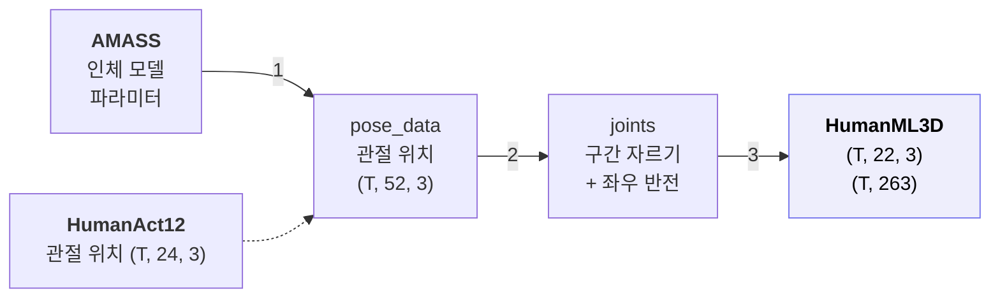
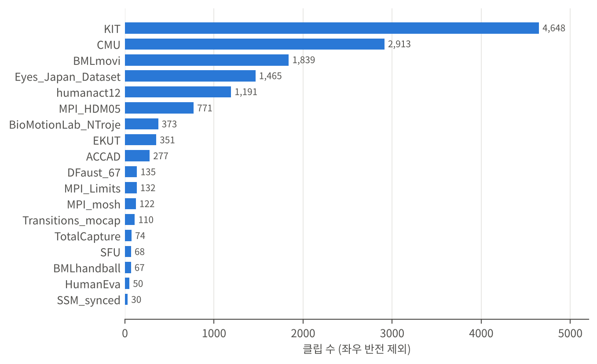
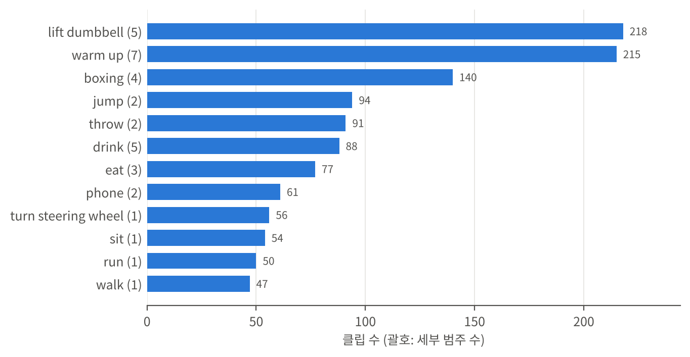
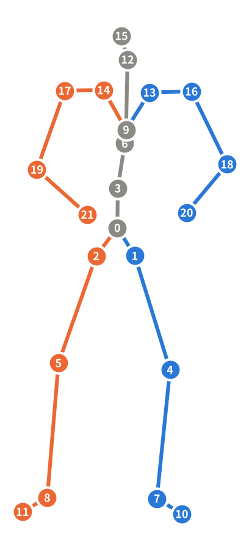
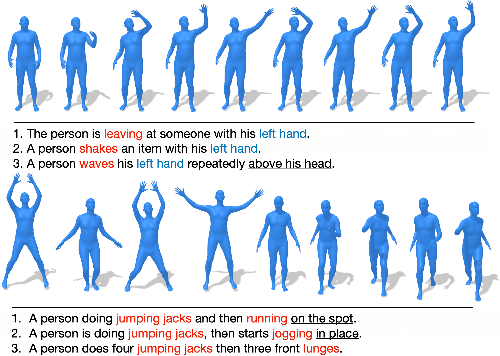
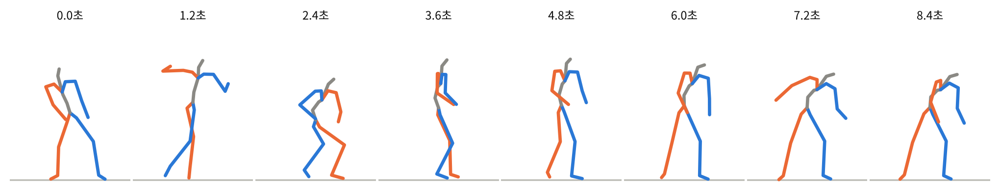
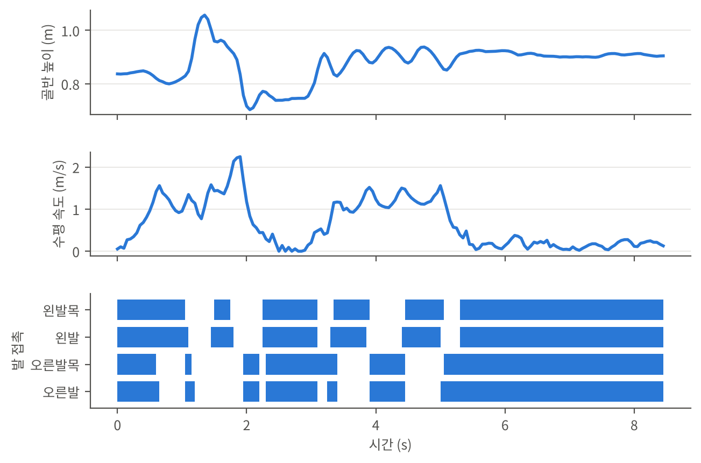

# HumanML3D 데이터셋 정리

작성일: 2026년 11월 2일 | 기준: HumanML3D GitHub 저장소(`EricGuo5513/HumanML3D`)와 저장소에 포함된 데이터 | Motion AI Lab

## 1. HumanML3D 개요

HumanML3D는 텍스트를 입력으로 모션을 생성하는 연구의 표준 벤치마크다(CVPR 2022). 사람 모션 14,616개와 그 모션을 설명하는 영어 문장 44,970개로 이루어지며, 좌우 반전본을 포함하면 모션은 29,232개다. MDM, MoMask 등 대부분의 텍스트-모션 생성 논문이 이 데이터셋으로 학습하고 평가한다.

HumanML3D는 모션을 직접 촬영한 데이터가 아니다. 원본 데이터셋인 AMASS와 HumanAct12의 모션을 잘라 가공하고, 사람이 쓴 문장을 붙여 만든다. 저장소에는 구간 정의, 문장, 변환 코드, HumanAct12가 들어 있고 AMASS는 들어 있지 않다.



**그림 1:** HumanML3D 생성 순서. 번호는 3.1절의 변환 단계와 같다. HumanAct12는 이미 관절 위치 형태이므로 `pose_data`에 그대로 들어간다.

| 구분 | 데이터셋 | 클립 수 | 저장소 포함 여부 |
|---|---|--:|---|
| 원본 | AMASS | 13,425 | 미포함, 별도 신청 후 다운로드 |
| 원본 | HumanAct12 | 1,191 | 포함 (`pose_data/humanact12.zip`) |
| 가공 | HumanML3D | 14,616 | 구간 정의, 문장, split, 변환 코드 |

**표 1:** HumanML3D와 원본 데이터셋. 클립 수는 `index.csv` 기준(좌우 반전 제외).

## 2. 원본 데이터셋

### 2.1 인체 모델

AMASS는 모션을 관절 위치가 아닌 인체 모델의 파라미터로 저장한다. 관절 위치를 얻으려면 인체 모델에 파라미터를 넣어 계산해야 한다.

※ 용어 설명

- SMPL: 체형 계수와 관절 회전값을 넣으면 사람 몸 형상과 관절 24개의 위치를 계산하는 표준 인체 모델
- SMPL+H: SMPL에 손 관절을 더한 모델. 관절 52개(몸 22 + 손 30)
- DMPL: SMPL 몸 형상에 살의 출렁임을 더하는 모델
- 체형 계수(`betas`): 키, 체격 등 사람마다 다른 몸 형상을 나타내는 숫자
- 자세 파라미터(`poses`): 프레임마다 각 관절의 회전값

| 모델 | 형식 | 받는 곳 |
|---|---|---|
| SMPL+H | `.npz` | `mano.is.tue.mpg.de` |
| DMPL | `.npz` | `smpl.is.tue.mpg.de` |

**표 2:** AMASS 파라미터를 관절 위치로 바꾸는 데 필요한 인체 모델 파일.

### 2.2 AMASS

#### 2.2.1 데이터 구성

AMASS는 18개 연구실의 광학식 모션 캡처 데이터를 SMPL+H 형식으로 통일한 모음이다. 각 연구실의 데이터는 하위 데이터셋으로 구분된다. HumanML3D의 `index.csv`로 하위 데이터셋별 클립 수를 세면 그림 2와 같다. KIT, CMU, BMLmovi 세 곳이 HumanML3D 전체 14,616개 중 약 64%를 차지한다.

※ 용어 설명

- 광학식 모션 캡처: 몸에 붙인 마커를 여러 대의 카메라로 촬영해 3D 위치를 기록하는 방식



**그림 2:** 원본 하위 데이터셋별 클립 수 (`index.csv` 기준, 좌우 반전 제외, 합계 14,616). `humanact12`는 AMASS가 아닌 별도 데이터셋이다.

#### 2.2.2 관절 구성

- SMPL+H 기준 52개 관절
- 몸 관절 22개 (0번 골반 포함)
- 손 관절 30개 (한 손 15개)

#### 2.2.3 데이터 형태

하위 데이터셋별 폴더 아래 시퀀스당 `.npz` 파일 1개로 저장된다. AMASS는 저장소에 없으므로, 아래는 AMASS 공식 SMPL+H 형식의 키 구조다.

```python
import numpy as np

data = np.load("CMU/01/01_01_poses.npz")

# data["poses"]             (T, 156)   관절 52개 × 회전값 3
# data["trans"]             (T, 3)     골반 이동 (m)
# data["betas"]             (16,)      체형 계수
# data["dmpls"]             (T, 8)     DMPL 계수
# data["gender"]            성별 문자열
# data["mocap_framerate"]   촬영 프레임 속도 (fps)
```

- 받는 곳: `amass.is.tue.mpg.de` (회원 가입 후 하위 데이터셋별 다운로드)

#### 2.2.4 특이사항

- 측정값이 아닌 추정값. 마커 위치에 SMPL+H 모델을 맞춰 얻은 파라미터임
- 하위 데이터셋마다 다른 촬영 프레임 속도. 60–250fps 범위
- z축이 위쪽인 좌표계 사용
- HumanML3D 저장소에 미포함. 사용자가 각 하위 데이터셋을 직접 받아야 함

### 2.3 HumanAct12

#### 2.3.1 데이터 구성

HumanAct12는 동작 범주가 붙은 3D 모션 데이터셋이다. PHSPD 데이터를 가공해 만들었으며, Action2Motion 논문에서 공개되었다. HumanML3D에는 클립 1,191개가 포함된다.

※ 용어 설명

- PHSPD: 편광 카메라로 촬영한 사람 자세·형상 데이터셋(Polarization Human Shape and Pose Dataset)

#### 2.3.2 클래스

HumanAct12는 12개 범주와 34개 세부 범주를 가진다. 파일 이름 끝의 `A0402` 같은 부분에서 앞 두 자리가 범주 번호(1–12), 뒤 두 자리가 세부 범주 번호다. 저장소의 `humanact12.zip`에서 직접 센 결과는 원 논문(Action2Motion)의 표와 일치한다.



**그림 3:** HumanAct12 범주별 클립 수 (합계 1,191, 괄호는 세부 범주 수, 합계 34).

| 번호 | 범주 | 한국어 | 세부 범주 | 클립 |
|--:|---|---|--:|--:|
| 1 | warm up | 준비 운동 | 7 | 215 |
| 2 | walk | 걷기 | 1 | 47 |
| 3 | run | 달리기 | 1 | 50 |
| 4 | jump | 점프 | 2 | 94 |
| 5 | drink | 마시기 | 5 | 88 |
| 6 | lift dumbbell | 덤벨 들기 | 5 | 218 |
| 7 | sit | 앉기 | 1 | 54 |
| 8 | eat | 먹기 | 3 | 77 |
| 9 | turn steering wheel | 운전대 돌리기 | 1 | 56 |
| 10 | phone | 전화하기 | 2 | 61 |
| 11 | boxing | 복싱 | 4 | 140 |
| 12 | throw | 던지기 | 2 | 91 |

**표 3:** HumanAct12 범주 목록. 번호는 파일 이름의 범주 코드와 같다.

#### 2.3.3 관절 구성

SMPL 기준 24개 관절의 3D 좌표로 저장된다. 손가락 관절은 없다.

#### 2.3.4 데이터 형태

클립당 `.npy` 파일 1개로 저장된다. 아래는 저장소의 `humanact12.zip`에 들어 있는 첫 번째 클립을 불러온 실제 출력이다.

```python
import numpy as np

data = np.load("humanact12/P01G01R01F0001T0064A0101.npy")

data.shape     # (64, 24, 3)   프레임 × 관절 × xyz
data.dtype     # float64
data[0, :3]    # 첫 프레임, 관절 0~2
# [[ 0.022 -0.316  2.616]
#  [ 0.098 -0.404  2.614]
#  [-0.047 -0.408  2.618]]
```

#### 2.3.5 특이사항

- HumanML3D의 원본 중 유일하게 클래스 라벨을 가진 데이터
- AMASS의 하위 데이터셋이 아닌 별도 데이터셋
- 파라미터가 아닌 관절 위치로 저장되어 인체 모델 계산 단계(3.1절 1단계)가 불필요
- 자료형이 float64. HumanML3D 최종 파일은 float32

## 3. HumanML3D 가공 데이터

### 3.1 변환 과정

변환은 저장소의 `raw_pose_processing.ipynb`와 `motion_representation.ipynb` 두 노트북으로 이루어진다. 아래 내용은 두 노트북의 코드를 직접 확인한 것이다. 단계 번호는 그림 1과 같다.

#### 3.1.1 1단계: AMASS 파라미터에서 관절 위치 계산 (`pose_data`)

- 성별에 맞는 SMPL+H 모델에 자세와 체형을 넣어 52개 관절 위치 계산. 체형 계수 `betas`는 16개 중 앞 10개만 사용
- 좌표축 변환. AMASS의 z축 위쪽 좌표계를 y축 위쪽 좌표계로 바꿈
- 프레임을 일정 간격으로 건너뛰어 20fps 근처로 낮춤

건너뛰는 간격은 정수로 내림하므로, 실제 프레임 속도는 다음과 같다.

$$
f_{\mathrm{eff}} = \frac{f_{\mathrm{src}}}{\lfloor f_{\mathrm{src}} / 20 \rfloor} \tag{1}
$$

- $f_{\mathrm{eff}}$: 변환 후 실제 프레임 속도 (fps)
- $f_{\mathrm{src}}$: AMASS 원본 촬영 프레임 속도 (fps)
- $\lfloor\cdot\rfloor$: 소수점 아래를 버리는 내림

60, 100, 120fps는 정확히 20fps가 된다. 250fps는 $250/12 \approx 20.83\,\mathrm{fps}$, 150fps는 $150/7 \approx 21.43\,\mathrm{fps}$ 가 된다.

#### 3.1.2 2단계: 구간 자르기와 좌우 반전 (`joints`)

- AMASS 클립: `index.csv`의 `start_frame`, `end_frame`으로 구간을 자르고 x좌표 부호를 뒤집음
- 일부 AMASS 하위 데이터셋은 앞부분을 먼저 잘라낸 뒤 구간 적용. Eyes_Japan_Dataset과 MPI_HDM05는 3초, TotalCapture와 MPI_Limits는 1초, Transitions_mocap은 0.5초
- HumanAct12 클립: 구간을 자르지 않고 전체 사용
- 모든 클립의 좌우 반전본 생성. 파일 이름 앞에 `M`을 붙이고, 문장의 left와 right도 서로 바꿈

#### 3.1.3 3단계: 표준화와 263차원 특징 계산 (`HumanML3D`)

- 관절 선택: AMASS(52개)와 HumanAct12(24개) 모두 앞 22개 관절만 사용
- 표준 골격 맞추기: 모든 클립을 클립 `000021`의 골격에 맞춤. 역기구학으로 관절 회전을 구한 뒤 표준 골격으로 위치를 다시 계산하고, 골반 이동 거리는 다리 길이 비율로 보정함
- 바닥 맞추기: 클립 전체에서 모든 관절 중 가장 낮은 높이를 바닥($y = 0$)으로 둠
- 위치와 방향 맞추기: 첫 프레임의 골반을 수평면 원점에 두고, 몸이 $+z$ 방향을 보도록 회전함
- 발 접촉 판정: 발 관절의 프레임 간 이동량으로 판정함. 코드의 높이 조건은 주석 처리되어 있음

※ 용어 설명

- 골격: 관절 사이 뼈 길이의 집합. 사람마다 다름
- 역기구학: 관절 위치로부터 그 자세를 만드는 관절 회전값을 거꾸로 계산하는 방법

발 접촉 판정 식은 다음과 같다.

$$
c_t = \mathbf{1}\left[\,\lVert \mathbf{p}_{t+1} - \mathbf{p}_t \rVert^2 < \tau\,\right] \tag{2}
$$

- $c_t$: 프레임 $t$ 에서 해당 발 관절의 접촉 여부, 1이면 접촉 (무차원)
- $\mathbf{1}[\cdot]$: 조건이 참이면 1, 거짓이면 0
- $\mathbf{p}_t$: 프레임 $t$ 에서 발 관절의 3D 위치 (m)
  - 발 관절: 왼발목(7), 왼발 끝(10), 오른발목(8), 오른발 끝(11)
- $\tau$: 판정 기준, 0.002 ($\mathrm{m}^2$)

기준을 속도로 바꾸면 프레임당 $\sqrt{0.002} \approx 0.045\,\mathrm{m}$ 이며, 20fps에서 약 0.89m/s보다 느리면 접촉으로 판정된다.

### 3.2 관절 구성

최종 데이터는 SMPL 몸 관절 0–21번, 즉 22개 관절로 이루어진다. 손가락 관절은 없다.



| # | 이름 | 의미 | # | 이름 | 의미 |
|--:|---|---|--:|---|---|
| 0 | pelvis | 골반(루트) | 11 | right_foot | 오른발 끝 |
| 1 | left_hip | 왼쪽 엉덩이 | 12 | neck | 목 |
| 2 | right_hip | 오른쪽 엉덩이 | 13 | left_collar | 왼쪽 쇄골 |
| 3 | spine1 | 허리 | 14 | right_collar | 오른쪽 쇄골 |
| 4 | left_knee | 왼쪽 무릎 | 15 | head | 머리 |
| 5 | right_knee | 오른쪽 무릎 | 16 | left_shoulder | 왼쪽 어깨 |
| 6 | spine2 | 등 가운데 | 17 | right_shoulder | 오른쪽 어깨 |
| 7 | left_ankle | 왼쪽 발목 | 18 | left_elbow | 왼쪽 팔꿈치 |
| 8 | right_ankle | 오른쪽 발목 | 19 | right_elbow | 오른쪽 팔꿈치 |
| 9 | spine3 | 가슴 | 20 | left_wrist | 왼쪽 손목 |
| 10 | left_foot | 왼발 끝 | 21 | right_wrist | 오른쪽 손목 |

**그림 4:** HumanML3D의 22개 관절. 위 그림은 샘플 클립 012314의 3.65초 자세를 정면에서 본 것이다 (파랑: 몸의 왼쪽, 주황: 몸의 오른쪽, 회색: 몸 중심). 정면에서 보므로 몸의 왼쪽이 그림의 오른쪽에 나타난다.

관절은 골반(0번)에서 시작하는 다섯 개의 운동학 사슬로 연결된다(`paramUtil.t2m_kinematic_chain`).

※ 용어 설명

- 운동학 사슬: 부모 관절에서 자식 관절로 이어지는 관절 순서. 부모가 움직이면 자식도 따라 움직임

```text
[0, 2, 5, 8, 11]       오른다리: 골반 - 엉덩이 - 무릎 - 발목 - 발끝
[0, 1, 4, 7, 10]       왼다리
[0, 3, 6, 9, 12, 15]   척추: 골반 - 허리 - 등 - 가슴 - 목 - 머리
[9, 14, 17, 19, 21]    오른팔: 가슴 - 쇄골 - 어깨 - 팔꿈치 - 손목
[9, 13, 16, 18, 20]    왼팔
```

### 3.3 텍스트 라벨

HumanML3D에는 “걷기”, “점프” 같은 정해진 클래스 라벨이 없다. 클립마다 사람이 직접 쓴 영어 문장 3개 이상이 붙어 있고, 이 문장이 라벨 역할을 한다. 그림 5는 모션 하나에 서로 다른 작업자가 쓴 문장 3개가 붙어 있는 예시다.



**그림 5:** HumanML3D 예시. 모션 하나(위 연속 자세)에 서로 다른 작업자가 쓴 문장 3개가 붙어 있다. 출처: HumanML3D GitHub 저장소의 `dataset_showcase.png` (MIT 라이선스).

문장 파일 한 줄은 `문장#단어/품사 단어/품사 ...#시작초#끝초` 형식이다. 시작초와 끝초가 모두 0이면 클립 전체를 설명하는 문장이다. 문장 안의 동사(`/VERB`)를 모으면 동작 종류를 대략 분류할 수 있으나, 공식 클래스는 아니다.

| 항목 | 값 |
|---|---|
| 텍스트 설명 수 | 44,970 (README 공식 값) |
| 고유 단어 수 | 5,371 |
| 평균 문장 길이 | 12단어 (직접 계산 12.4단어) |
| 총 모션 길이 | 28.59시간 |
| 클립 길이 | 2–10초 (평균 7.1초) |
| split | train 23,384 / val 1,460 / test 4,384 (반전본 포함 클립 수) |

**표 4:** HumanML3D 공식 통계(README)와 직접 확인한 값.

### 3.4 데이터 형태

최종 결과물은 다음 파일들로 이루어진다. $T$ 는 프레임 수다.

| 파일 | shape | 자료형 | 내용 |
|---|---|---|---|
| `new_joints/<이름>.npy` | $(T, 22, 3)$ | float32 | 표준 골격의 관절 위치 (m), y축 위쪽 |
| `new_joint_vecs/<이름>.npy` | $(T, 263)$ | float32 | 학습용 263차원 특징 |
| `texts/<이름>.txt` | 줄 3개 이상 | 텍스트 | 문장#품사#시작초#끝초 |
| `{train,val,test}.txt` | 줄 단위 | 텍스트 | split별 클립 이름 |
| `Mean.npy`, `Std.npy` | $(263,)$ | float32 | 공식 정규화 통계 |
| `index.csv` | 14,616행 | 텍스트 | 원본 경로, 시작·끝 프레임, 새 이름 |

**표 5:** HumanML3D 최종 결과물 파일.

#### 3.4.1 index.csv

원본 클립과 HumanML3D 클립 이름의 대응표다.

```python
import pandas as pd

index = pd.read_csv("index.csv")
index.head(3)
```

|  | source_path | start_frame | end_frame | new_name |
|--:|---|--:|--:|---|
| 0 | `./pose_data/KIT/3/kick_high_left02_poses.npy` | 0 | 117 | `000000.npy` |
| 1 | `./pose_data/humanact12/humanact12/P11G01R02F1812T1847A0402.npy` | 0 | −1 | `000001.npy` |
| 2 | `./pose_data/KIT/3/jump_left02_poses.npy` | 0 | 83 | `000002.npy` |

**표 6:** `index.csv`의 앞 3행. 프레임 번호는 20fps 기준이다. HumanAct12 클립의 `end_frame`은 −1이며, 변환 코드에서 쓰이지 않는다.

#### 3.4.2 new_joints, new_joint_vecs

샘플 클립 012314의 관절 위치와 263차원 특징을 불러온 실제 출력이다.

```python
import numpy as np

joints = np.load("HumanML3D/new_joints/012314.npy")
joints.shape        # (170, 22, 3)   프레임 × 관절 × xyz
joints[0, :3]       # 첫 프레임, 관절 0~2 (m)
# [[ 0.     0.837  0.   ]
#  [ 0.081  0.773  0.007]
#  [-0.033  0.732  0.001]]

feats = np.load("HumanML3D/new_joint_vecs/012314.npy")
feats.shape         # (170, 263)     프레임 × 특징
feats[0, :5]        # [ 0.106 -0.002  0.002  0.837  0.081]
```

263차원 특징의 구성은 다음과 같다.

| 인덱스 | 이름 | 차원 | 내용 |
|---|---|--:|---|
| 0 | root_rot_vel | 1 | 골반의 수직축 회전 속도 (rad/프레임) |
| 1–2 | root_lin_vel_xz | 2 | 골반의 수평 이동 속도, 몸 기준 좌표 (m/프레임) |
| 3 | root_y | 1 | 골반 높이 (m) |
| 4–66 | ric | 63 | 골반 기준 관절 위치 21 × 3 (m) |
| 67–192 | rot_6d | 126 | 관절 회전 21 × 6, 역기구학으로 구한 6D 회전 |
| 193–258 | local_vel | 66 | 관절 속도 22 × 3 (m/프레임) |
| 259–262 | foot_contact | 4 | 발 접촉 0/1: 왼발목, 왼발 끝, 오른발목, 오른발 끝 |
|  | 합계 | 263 |  |

**표 7:** 263차원 특징의 구성 (`motion_representation.ipynb`의 `process_file` 순서).

※ 용어 설명

- 6D 회전: 3×3 회전 행렬의 앞 두 열(6개 숫자)로 회전을 나타내는 방식

#### 3.4.3 texts

```python
with open("HumanML3D/texts/012314.txt") as f:
    lines = f.read().splitlines()

lines[1]
# 'walking sideways and almost falling.#walk/VERB sideways/ADV
#  and/CCONJ almost/ADV fall/VERB#0.0#0.0'

lines[1].split("#")
# ['walking sideways and almost falling.',               문장
#  'walk/VERB sideways/ADV and/CCONJ almost/ADV fall/VERB', 단어/품사
#  '0.0',                                                시작초
#  '0.0']                                                끝초
```

#### 3.4.4 split

```python
with open("HumanML3D/train.txt") as f:
    train = f.read().split()

len(train)    # 23384
train[:3]     # ['000001', '000002', '000003']
```

### 3.5 샘플 012314 출력

`hml3d_loader.py`로 샘플 클립 012314를 불러와 요약한 출력이다. 원본은 Eyes_Japan_Dataset의 테니스 서브 동작이다.

```bash
python hml3d_loader.py --root /path/to/HumanML3D --name 012314
```

```text
[클립] 012314   미러=False
  joints   (170, 22, 3) float32
  features (170, 263) float32
  프레임 170개 = 8.50초 (20fps)

[텍스트]
  1. a person appears to be playing tennis and shoots the ball with
     the racket in his right hand   (구간 0.0~0.0초)
  2. walking sideways and almost falling.   (구간 0.0~0.0초)
  3. a person lunges and hits something, then backing up.   (구간 0.0~0.0초)

[발 접촉 비율] 왼발목 0.79, 왼발 0.81, 오른발목 0.75, 오른발 0.75

[관절 위치]
  최저 높이(y) 0.0000 m
  골반 높이 범위 0.703 ~ 1.057 m

[특징→위치 복원 검증] 최대 오차 1.19e-06 m
[정규화] 평균 -0.132, 표준편차 1.468

[원본 위치 (index.csv)]
  ./pose_data/Eyes_Japan_Dataset/yamaoka/tennis-15-first service-yamaoka_poses.npy
  start_frame=149, end_frame=320 (20fps 기준)
```



**그림 6:** 샘플 012314의 연속 자세 (1.2초 간격, 정면 시점, 회색 선은 바닥 $y = 0$).



**그림 7:** 샘플 012314의 263차원 특징 일부. 위: 골반 높이 (`root_y`), 가운데: 골반 수평 속도 (`root_lin_vel_xz` 크기 × 20), 아래: 발 접촉 4개(`foot_contact`, 파란 구간이 접촉).

### 3.6 특이사항

- 263차원 특징은 원래 구간보다 1프레임 짧음. 다음 프레임과의 차이(속도)를 포함하기 때문임. 샘플 012314의 구간은 149–320(171프레임)이지만 파일은 170프레임이며, `new_joints`도 263차원 특징에서 복원해 저장한 것이라 같은 170프레임임
- 원본 250fps 시퀀스는 약 20.83fps로 변환됨. Eyes_Japan_Dataset에 250fps 시퀀스가 있음
- 바닥은 실제 바닥이 아닌 클립 안 모든 관절 중 가장 낮은 높이
- 발 접촉 값은 이동량 기준(약 0.89m/s)만으로 만든 값이며, 높이는 판정에 쓰이지 않음
- 표준 골격(클립 `000021`)으로 맞추는 과정에서 원본의 체형 정보가 사라짐
- `rot_6d`의 회전 126개는 원래 SMPL 회전이 아닌, 관절 위치에서 역기구학으로 다시 계산한 값
- `index.csv`의 프레임 번호는 20fps 기준이며, 일부 AMASS 하위 데이터셋은 앞부분이 잘려 있음(3.1절 2단계)
- 문장 줄 수 차이: 반전본을 뺀 원본 14,616개 파일의 문장 줄 수는 43,692줄로, README의 44,970과 다름

## 4. 정리

| 항목 | AMASS | HumanAct12 | HumanML3D |
|---|---|---|---|
| 구분 | 원본 | 원본 | 가공 |
| HumanML3D 내 클립 수 | 13,425 | 1,191 | 14,616 (반전 포함 29,232) |
| 라벨 | 없음 | 12개 범주, 34개 세부 범주 | 클립당 영어 문장 3개 이상 |
| 저장 방식 | SMPL+H 파라미터 | 관절 위치 | 관절 위치 + 263차원 특징 |
| 관절 수 | 52 (몸 22 + 손 30) | 24 | 22 |
| 프레임 속도 | 60–250fps | — | 20fps (일부 약 20.83, 21.43fps) |
| 파일 형식 | `.npz` | `.npy` (float64) | `.npy` (float32), `.txt`, `.csv` |
| 받는 곳 | `amass.is.tue.mpg.de` | HumanML3D 저장소 | HumanML3D 저장소 + 변환 코드 실행 |

**표 8:** 세 데이터셋 비교.
